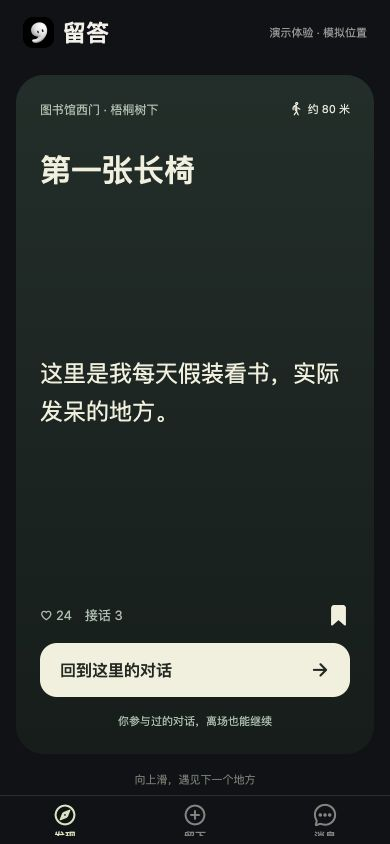

# 留答

留答是一款以地点为交流载体的 App。你可以一张张翻看附近的地点，走近后读到别人留下的话，也可以在现场接一句。参与过的对话，离开后还能继续。



## 当前原型

- **发现**：上滑切换地点卡片，查看留话预览，收藏想去的地方。
- **留下与接话**：模拟走近地点，解锁全文，在模拟到场后留言。参与过的对话可以在离场后继续。
- **个人中心**：编辑本机昵称和头像，查看自己留下的话、参与的对话和收藏。

当前 App 用模拟位置和本机数据演示流程。真实 GPS、跨设备同步、微信和 Apple 登录仍待接入。

## 快速启动

接受私有仓库邀请后，安装 Git 和 Node.js 24。在终端运行：

```sh
git clone --branch feature/app-profile https://github.com/Vans66660/liuda.git
cd liuda/mobile
npm ci
npx expo login
npm start -- --go
```

电脑和手机连同一个 Wi-Fi，扫描终端二维码。iPhone 上的 Expo Go 要登录与终端相同的 Expo 账号，并支持项目使用的 Expo SDK 58。首次打开留答可以点「先逛逛」。在电脑上预览可运行 `npm run web`。

[App 代码与开发说明](https://github.com/Vans66660/liuda/tree/feature/app-profile/mobile) · [Expo Go 启动指南](https://docs.expo.dev/get-started/start-developing/)

## 早期原型

[微信小程序原型说明](MINIPROGRAM.md) 保留了微信开发者工具、定位和云开发的配置步骤。
