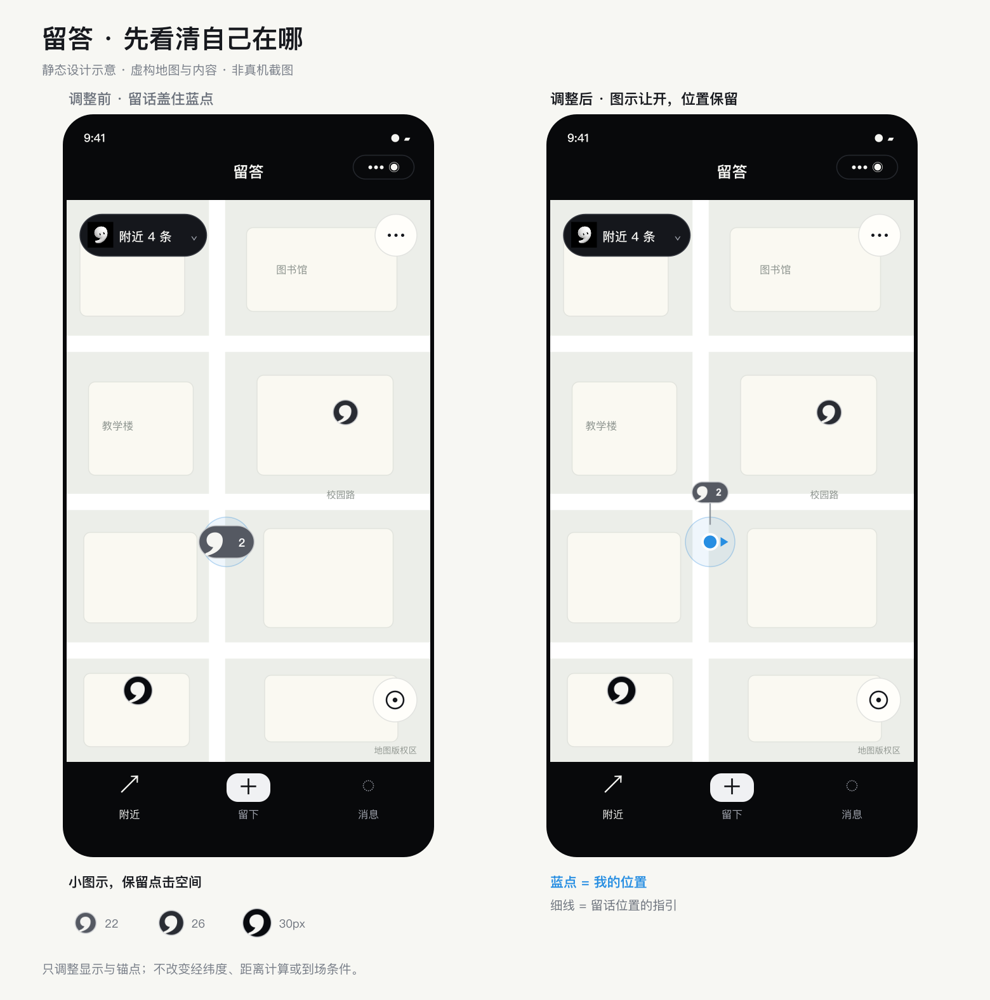

# 逗号与当前位置的显示

更新：2026-10-26，客户端源码已修改。关联地图界面精简 [Issue #2](https://github.com/Vans66660/liuda/issues/2)、[PR #3](https://github.com/Vans66660/liuda/pull/3)。

## 设计

- 蓝点表示用户当前位置，沿用微信原生 `show-location`；精度范围改为浅蓝，避免与黑灰留言标记混淆。
- 普通 / 有回应 / 热门的可见高度改为 **22 / 26 / 30px**，不随缩放无限变大。多条留言只增加 16px 数字区域，最多显示 `9+`。
- 图标围绕气泡保留至少 44px 的透明范围，减少缩小后难点的问题；实际点击命中仍需手机确认。
- 逗号即将遮住蓝点时，图示向上、右、下或左移动 52px，优先避开蓝点和相邻气泡。细线指回原始坐标，原生 marker 的经纬度不变。
- 地点与用户几乎重合时，细线在蓝点附近留空，不再叠加灰色落点；稍远时显示细线终点。
- 缓冲区为进入与退出避让设置不同边界，原方向仍合适时优先保留，减少定位轻微波动引起的跳动。
- 点击入口、聚合数量、选中描边和底部卡片沿用现有机制。3D 示意使用相同的小逗号，但没有原生蓝点避让逻辑。

## 实现边界

以当前缩放级别的二维 Mercator 投影估算屏幕碰撞；地图当前禁止旋转和倾斜。拖动不改变相对位置，缩放结束和定位更新时重新计算。只对少量本地分组做布局，不新增请求，也不在定位回调中编码图片。图标由脚本预生成。

定位保护范围针对蓝点与方向提示，并不覆盖整个定位误差圈。这里改善的是显示关系；不会提高 GPS 精度、识别楼层，或改变发布、回复的到场条件。原始留言坐标、分组 ID、地点 ID 和热度算法保持原样。

原生锚点按图像比例指定，依据 [腾讯位置服务 map 组件说明](https://github.com/TencentLBS/tencentmap-miniprogram-skill/blob/main/references/map_component_guide.md#marker)；没有假定 `zIndex` 能控制原生定位蓝点的层级。

## 素材与查看

- `miniprogram/utils/map-marker-style.js`：客户端和生成脚本共用的尺寸、锚点。
- `scripts/build-map-pins.cjs`：生成 540 个本地 PNG，含四个方向、蓝点附近留空和选中状态。总图片字节约 1.15MB，实际编译包大小以开发者工具为准。
- `scripts/build-marker-location-preview.cjs`：用生成的 PNG 绘制下面的静态示意，不运行小程序。

重新编译并扫码预览客户端即可，无需部署云函数。重点观察原来同地两条留话的位置：蓝点是否清楚、逗号是否能点开、放大缩小后显示是否合适。

本轮做 JavaScript 语法及 Git 差异格式检查，并目视查看静态设计图；未运行自动化、模拟器或真机功能测试。原生锚点显示、触摸区域及移动时的体验尚待真机确认。
